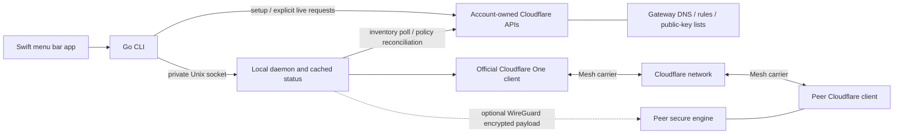

# meshscale: a small control layer over Cloudflare Mesh

Historical development measurements use anonymized host labels and synthetic peer addresses. Documented address ranges and the MagicDNS resolver are retained for technical accuracy. These observations are not independent performance guarantees; raw private infrastructure evidence is excluded from the public tree.

## Scope and authorship

meshscale explores a specific product question: can a solo developer get a
Tailscale-like workflow while keeping Cloudflare Mesh responsible for carrying
traffic? The result is a Go CLI/daemon, a SwiftUI menu bar app, account setup,
device discovery and DNS, access rules, SSH, and optional Linux secure/exit-node
features. It is a prototype with live evidence, not an audited VPN product or a
claim of production maturity. The initial history spans 2026-10-25–26.

The maintainer directed AI coding agents as product owner and architect: defining the
experience, choosing boundaries, setting acceptance criteria, reviewing work,
and steering investigations using real failures. Agents wrote substantial code,
tests, scripts and documentation. This is an account of those engineering
choices and their evidence, not a claim that the maintainer manually authored every
implementation. Commit history retains co-author attribution.

## Constraints and architecture

The existing Mac, Linux host, containers and phone already used Tailscale.
Experiments had to preserve Internet access and a recovery path. The default
backend therefore uses the official Cloudflare client with a narrowly scoped
Include profile. A separate native WireGuard backend is experimental because
it depends on an undocumented registration API and has unresolved support/terms
questions; it is not necessary for the default product.

The current solo design needs no meshscale-hosted control server. Credentials
and private keys stay on devices; public keys and configuration use the user's
account. This reduces infrastructure and custodial responsibilities, at the
cost of account API permissions, eventual consistency and vendor dependency.

The explicit decision **not to build direct device links** is central
(`5b83d5d`, [plan](plan.md)). NAT traversal, peer path selection and a new data
plane would move security-critical responsibility from Cloudflare into this
project and rebuild much of Tailscale's core. The observed roughly 200–235 Mb/s
plain Mesh throughput was adequate for the intended use. Optional WireGuard
over Mesh protects payloads end to end while retaining Cloudflare as carrier;
it does not introduce a direct transport.

## Setup and safety decisions

Early node traffic failed with ICMP host unreachable despite successful
registration. Investigation found the poorly surfaced
`offramp_warp_enabled` connectivity setting behind the dashboard's device
reachability switch. API schema, SDK and official CLI evidence showed that
setup could PATCH just that boolean while preserving other connectivity
settings. The implementation removed the dashboard step; an already-ready
account required **14 GETs and zero writes** in a documented full-setup check
(`b10c7ae`, [setup evidence](setup.md)). "Zero-touch" is bounded: fresh-account
Free-plan activation is still a billing/UI dependency, and the OAuth client was
private during verification. This is not proof that arbitrary new users can
complete onboarding without assistance.

A Mac enrollment experiment once cut the machine off after `warp-cli connect`
ran before verified team registration. Turning WARP off restored it. Consumer
WARP taking the default route was the leading explanation, not a proven capture
of every failure mechanism. That failure led to a guard requiring Team
registration in the selected organization, WARP mode and a safe Mesh-only
Include profile before connection/reconnection. Unknown or broad/default
profiles fail closed. Existing Team enrollment passed real Mac down/up checks;
first-time browser enrollment and consumer replacement still have unverified
interactive cases (`d59394c`, [Mac enrollment guide](macos-enrollment.md)).

## Bugs that crossed component boundaries

**CGNAT overlap and five-second DNS stalls.** Mesh's `100.96.0.0/12` sits within
Tailscale's `100.64.0.0/10`. The lead traced DNS delays on test-server to the first
resolver, MagicDNS `100.100.100.100`: WARP's policy lookup at priority 5209 ran
before Tailscale's table-52 lookup at 5270. A `/32` in table 52 could not beat an
earlier successful lookup in another table. An overlapping Tailscale peer,
`100.89.10.10`, was captured too.

The fix is an owned policy rule for the Mesh prefix that consults table 52 just
before WARP. Tailscale's host routes win; absent destinations fall through to
WARP. Discovery matters: a live WARP restart moved its priority to **5199**, and
the exception followed to **5198**. A table-52 default route invalidates that
assumption, so the manager warns and removes/skips the exception for a selected
Tailscale exit node. An instance-owned netlink handle and change notifications
avoid new per-tick subprocesses or unchanged routing dumps. Tests cover the
lifecycle and error cases; an isolated kernel namespace verifies both route
choices and removal after a default-route event.

On test-server the hand-added priority-5200 rule was removed under an armed
four-minute rollback. MagicDNS and the overlapping peer then selected
`tailscale0`, while `100.96.0.10` selected `CloudflareWARP`. Five DNS lookups had a
**9.59 ms median**, and Mesh SSH returned the Mac's hostname. The same address
space overlap exists on macOS, but route aggregation, peer host routes and
interface scope differ; no Mac routing change or live route-table verification
was made ([host notes](linux-host.md)).

**Status as a local operation.** Earlier documented status checks took roughly
10 seconds (a prior three-run median was 10.23 seconds); the task reported about
10.5 seconds before the DNS diagnosis. Even after DNS recovery, synchronous
API/client work remained. This follow-up measured the installed pre-change
binary at **6,836.62 ms median of five**. Its build metadata identifies
`1ae5e43` with uncommitted changes, so it is not an exact clean source baseline.

Status now reads a daemon-owned snapshot over the private control socket. The
existing inventory poller refreshes it, and `--refresh` explicitly requests a
live update. Reads combine cached registrations, devices and reachability with
current daemon connection/secure/exit state; failures retain the prior inventory
and expose its age/error. No Cloudflare or `warp-cli` calls occur in the hot
path. Measured text status fell to **7.28 ms median of five** and JSON to
**6.64 ms**, below the 200 ms target. The trade-off is up to one poll interval
of inventory age, longer during error backoff. This does not establish the
whole Mac UI refresh time: its separate safety-check path still does live work
([measurement detail](status-verification.md)).

**MenuBarExtra popover gap.** Switching to a shorter pane left a gap below the
menu bar. The reported symptom was a window retaining the first pane's height
and centering shorter content. Commit `558dd89` records the implemented fix as
pinning the containing NSWindow's top edge when it resizes. This distinction
matters: adjusting SwiftUI spacing alone would not establish correct window
geometry. The source and snapshot checks are evidence of the repair; this
write-up does not claim a new interactive Mac verification.

## Secure identity, exits and performance investigation

Secure mode uses established WireGuard implementations over Mesh, with device
private keys kept local and public keys distributed through account-owned
Gateway lists. SSH associates secure peers with their WireGuard keys, validates
address/interface provenance and prevents fallback to plain Mesh identity once
a secure identity is required. Gateway-list distribution still trusts account
administrators; this is not a signed, independently trusted key directory
(`742dc74`, [secure mode](secure.md)).

Linux exit nodes add versioned advertisements, pinned selection, forwarding,
NAT and route/resolver recovery. Lost advertisements or a stopped secure engine
must block Internet traffic instead of leaking through the physical uplink.
Isolated-kernel and live container checks demonstrated those failures and
recovery, including dual-stack egress. These results concern Linux; phone/Mac
exit selection is not established by them (`16f536a`, `1ae5e43`, `cb454ed`,
[exit-node evidence](exit-nodes.md)).

Throughput work tested hypotheses rather than blaming double encryption. Packet
captures showed different TCP initial sequence numbers/options at the two ends
of plain Mesh connections: **30/30 matched SYNs were rewritten**. Further
captures found **1,290/1,968** eligible plain ACKs arriving before the bytes
reached the receiver, versus **0/1,735** secure ACKs. This establishes intervening
TCP termination/proxying, without locating every Cloudflare internal stage.
Plain sender retransmissions therefore cannot be compared directly with
end-to-end secure retransmissions.

A direct Docker-bridge WireGuard control reached **1,504.6/1,519.9 Mb/s** for
one/four streams, suggesting raw local WireGuard capacity was not the Mesh
bottleneck in that setup. Later production-interface runs raised secure
single-stream mean from **97.85 to 146.34 Mb/s (+49.6%)** with route-scoped BBR;
four streams rose from **102.70 to 121.40 Mb/s (+18.2%)**. Receive drops and
retransmissions increased. Larger WARP receive buffers removed measured drops
but did not improve secure throughput in that batch, so buffer tuning stayed
opt-in and reversible. These were shared-host, sequential experiments, not
independent-host capacity guarantees ([captures and controls](secure.md),
[spike method](../spike/secureperf/README.md)).

## Event-driven daemon and code audit

**Idle cost.** The Linux daemon polled: every few seconds it ran `warp-cli`,
`ip`, `nft` and `firewall-cmd` to re-derive state that rarely changed. On
test-server that was 37 process launches a minute and about 1.9% of a core while
idle. The daemon now listens instead: rtnetlink route, link, address and rule
groups (rules from a raw multicast socket, since the netlink library has no
rule subscription), firewalld D-Bus signals, and `warp-cli --listen status`.
A one-minute safety pass keeps the old full reconcile as a backstop. Measured
on the same host: 5 launches in two minutes and 0.075% CPU, roughly 25x less,
at a cost of about 3 MB of RSS ([measurements](performance.md)). Replacing CLI
parsing with netlink was only accepted after a live diff showed the snapshot
matched `ip -j` exactly, table names and `default` destinations included.

**Implementation review.** Reviewing code and checking its behavior in isolated integration tests exposed bugs that existing unit tests had missed:

- The firewalld D-Bus client called a method on the wrong interface, and one
  that does not exist. Both were confirmed with `busctl`, then fixed and pinned
  by a live test against `firewall-cmd`.
- One duplicate key or malformed record in the shared directory failed secure
  mode for the whole account. Now only the conflicting devices are dropped,
  with a warning, and the local device still fails closed if it is among them.
- Kernel carrier firewall rules embedded the Mesh IP and were reused on
  restart. An address change would have left a DROP rule for the new address.
  They now live in a dedicated chain that is rebuilt on each start. The
  migration was verified in a network namespace and then on test-server.
- `set --exit-node` with a conflicting flag published to Cloudflare before
  rejecting the command. Reachability probes cut off at the batch deadline
  were never cached, so slow hosts were reported offline forever. A
  singleflight refresh ran under its first caller's context, so one
  disconnecting client failed every joined caller.
- Three copies of "is this a Mesh address" disagreed. Two accepted all of
  `2606:4700:cf1::/48`, which also contains WARP's own `cf1:2000::1`.

Each fix landed with a regression test that fails on the old code.

## Limits and next work

Formatting, vet and race tests are acceptance checks, not substitutes for
review, security audit or broader field use. Important limits include private
OAuth distribution, fresh-account setup, an experimental native backend,
unverified Mac overlap behavior, unaudited secure/SSH policy, and absent
cross-platform secure exits. Some earlier planning notes are historical; dated
verification sections identify later evidence.

Remaining limits after the idle-cost work are listed in
[performance](performance.md): one unexplained `registration show` per couple of
minutes, and nft/firewalld mutations that still shell out when something
actually changes.
